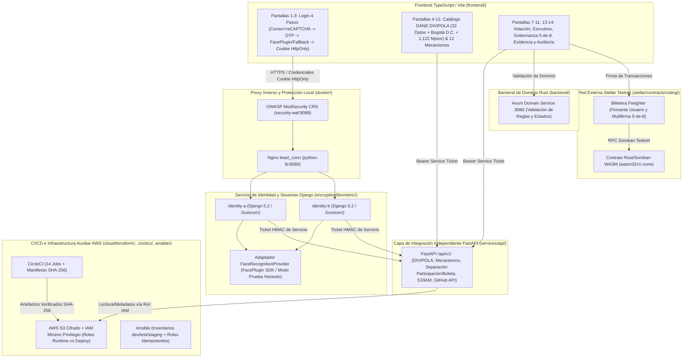

# 17. Arquitectura del MVP, Operación Local y Despliegue Controlado

**Estado:** implementado y verificado localmente (Octubre 2026)  
**Límite obligatorio:** Consensus es un MVP educativo y experimental para estudiar participación democrática configurable, identidad digital de laboratorio y evidencia verificable en Stellar Soroban Testnet. No es un sistema certificado para elecciones oficiales, no ofrece voto secreto criptográfico en cadena pública y no sustituye el censo electoral de la Registraduría Nacional del Estado Civil.

---

## 1. Diagrama de Arquitectura del Monorepo



---

## 2. Separación de Responsabilidades

1. **`frontend/` (TypeScript + Vite):** Presenta el flujo de autenticación de 4 pasos como primera pantalla obligatoria, los selectores dependientes del catálogo oficial DANE DIVIPOLA y los paneles de participación y administración. **Nunca decide por sí solo si un voto es válido** ni guarda tokens de sesión o claves privadas en `localStorage`.
2. **`encryption/biometric/` (Python + Django):** Gestiona la identidad de laboratorio:
   - Paso 1: Normalización de correo, limitación de intentos y verificación en servidor de Google reCAPTCHA.
   - Paso 2: Generación CSPRNG de código OTP de 6 dígitos con expiración de 5 minutos, máximo 3 intentos, enfriamiento de 60 segundos e invalidación inmediata tras su primer uso.
   - Paso 3: Registro y revocación de consentimiento informado (Ley 1581 de 2012), adaptador desacoplado `FaceRecognitionProvider` (`FacePluginSdkProvider`) y método alternativo autorizado.
   - Paso 4: Emisión de sesión mediante cookie firmada `HttpOnly`, `SameSite=Lax`, `Secure`, control de acceso por roles (`participante`, `administrador`, `auditor`), intercambio de tickets HMAC entre servicios (`/v1/auth/service/exchange`) y auditoría sin PII ni secretos.
3. **`services/api/` (Python + FastAPI):** Capa de integración independiente bajo `/api/v1/` con validación tipada Pydantic, trazabilidad `X-Request-Id`, límite de tamaño de petición, catálogo completo DANE DIVIPOLA, plantillas de mecanismos de participación, separación explícita entre registro de participación y contenido de la boleta, consulta de metadatos fijados en GitHub API y adaptador de artefactos para AWS S3 con IAM de mínimo privilegio.
4. **`backend/` (Rust + Axum):** Valida reglas de dominio de elecciones, transiciones de estado (`Draft -> Open -> Closed / Cancelled`) y unicidad de participación.
5. **`stellar/contracts/voting/` (Rust + Soroban WASM):** Contrato inteligente compilado a WebAssembly (`wasm32v1-none`) que aplica en Stellar Testnet las reglas de administración, ventana temporal, opciones, autorización, voto único y conteo público.

---

## 3. Requisitos del Entorno e Inicio Local

### Requisitos

- **Node.js** >= 22 y `npm`
- **Python** 3.11 o 3.12
- **Rust** >= 1.84 con target `wasm32v1-none` y Stellar CLI (para compilación y despliegue del contrato WASM)
- **Docker Compose** (opcional para levantar las réplicas tras Nginx y OWASP CRS WAF)

### Pasos de Instalación y Ejecución Local

1. Copiar variables de entorno (sin incluir jamás secretos reales en Git):
   ```powershell
   Copy-Item .env.example .env
   Copy-Item frontend/.env.example frontend/.env
   ```
2. Instalar dependencias y compilar el frontend:
   ```powershell
   cd frontend
   npm.cmd ci
   npm.cmd test
   npm.cmd run build
   ```
3. Ejecutar comprobaciones y pruebas de Django (`encryption/biometric`):
   ```powershell
   cd encryption/biometric
   $env:DJANGO_SECRET_KEY="local-test-secret-key-0123456789abcdef0123456789abcdef"
   python manage.py check
   python manage.py test lab -v 2
   ```
4. Ejecutar pruebas de FastAPI (`services/api`) e integración E2E:
   ```powershell
   $env:PYTHONPATH=".;encryption/biometric"
   python -m pytest services/api/tests/test_api.py tests/test_integration_e2e.py -v
   ```
5. Ejecutar análisis estático, escaneo de secretos, validación DIVIPOLA/Terraform/Ansible/CircleCI y generación de manifiesto SHA-256:
   ```powershell
   python scripts/verify_pipeline_and_artifacts.py --strict --emit-artifacts
   ```

---

## 4. Configuración de Correo, reCAPTCHA y Recuperación

- **Google reCAPTCHA:** Configura `RECAPTCHA_SITE_KEY` y `RECAPTCHA_SECRET_KEY` en `.env`. El backend verifica cada token contra `https://www.google.com/recaptcha/api/siteverify`. En desarrollo local (`RECAPTCHA_DEV_TEST_MODE=true` sin clave secreta de producción), el servidor solo acepta el token explícito de prueba `test-recaptcha-pass-consensus` y rechaza cualquier token inválido o manipulado.
- **Proveedor de Correo OTP:** Configura `EMAIL_PROVIDER_MODE=smtp` junto con `SMTP_HOST`, `SMTP_PORT`, `SMTP_USER` y `SMTP_PASSWORD` para envío real. En laboratorio local (`EMAIL_PROVIDER_MODE=sandbox`), los códigos se entregan en la bandeja efímera de pruebas sin exponerse jamás en los logs de auditoría.
- **Procedimiento de Recuperación:** Todo el estado de infraestructura está versionado en Terraform (`cloud/terraform/`), la configuración de servidores en Ansible (`ansible/site.yml`), el catálogo territorial puede regenerarse en cualquier momento con `python data/territories/import_divipola.py`, y el escenario de pruebas se restablece limpiamente reiniciando los contenedores o invocando el reinicio del almacén en memoria.
